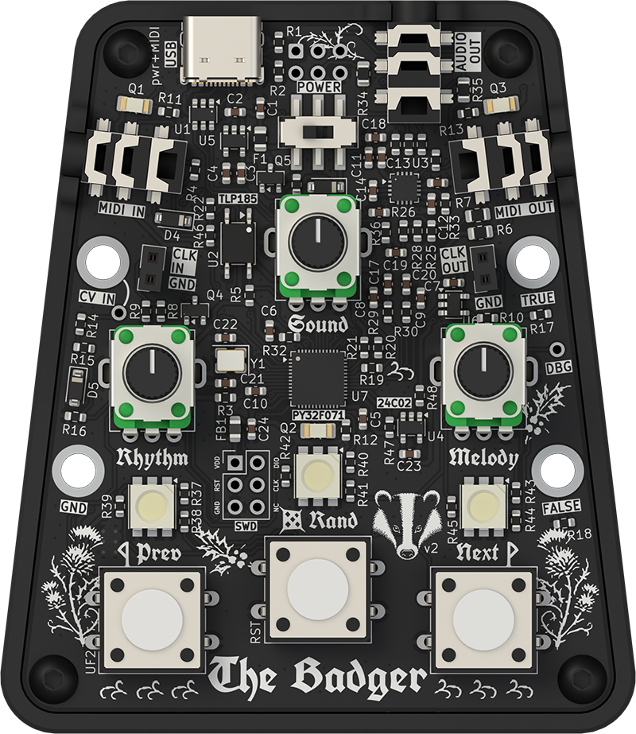
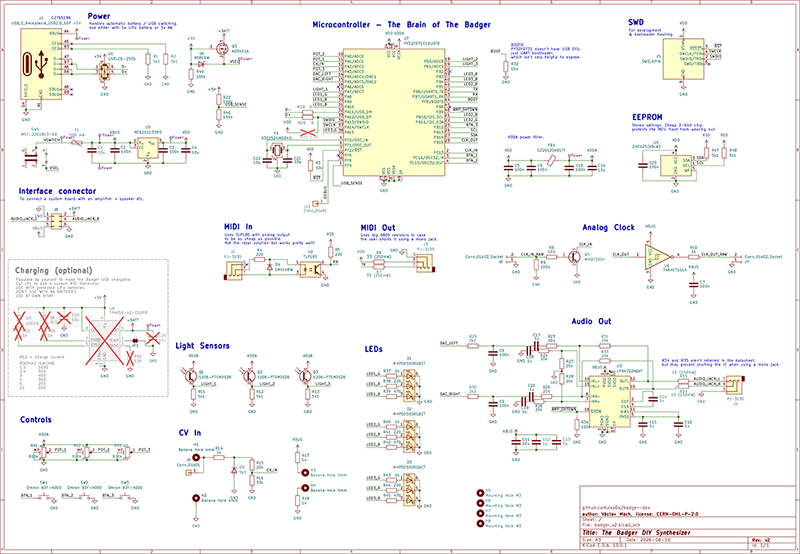

# The Badger

The Badger is an open-source synth that packs 18 presets – synths, drums, and drones – into a small, pocketable device. Use the knobs to steer its internal generative sequencer and tweak the melodies yourself, or hit the randomizer to discover new patterns and textures at the press of a button. It also comes with MIDI (both TRS and USB), CV, and clock connections for patching into a bigger setup – or chaining multiple Badgers together. The audio is not particularly hi-fi, but that's exactly where the fun lives. Take it with a grain of salt, but: “the cheapest, *fully featured* synth ever.”

See [badger-quick-guide-en.pdf](./manuals/badger-quick-guide-en.pdf) for the quick guide.

See [badger-full-manual-en.md](./manuals/badger-full-manual-en.md) or [badger-full-manual-en.pdf](./manuals/badger-full-manual-en.pdf) for the full user manual (controls, presets, MIDI...).

## Technical Specs

- PY32F071C1BU6TR ARM Cortex M0+
- 48 MHz clock speed
- 16 kB RAM, 128 kB ROM
- MIDI in, MIDI out (TRS Jack, Type A)
- Stereo audio out using a 12-bit DAC
- Headphone amplifier with 200mW per channel at 32Ω load
- Patch points for analog clock in and out
- Banana-style holes for CV IN (0.25V to 5V), ground, True (5V ref), False (0V ref)

## Schematic

## Firmware update

Download the UF2 firmware from the *Releases*. Connect The Badger to your computer, hold *PREV* and turn the device on. The *PREV* LED should light red. Then just drag the UF2 file onto the *BADGERBOOT* drive. This applies to already built Badgers. When you build your own Badger from scratch, you need to flash the bootloader first. See [HOW_TO_DEVELOP.md](./HOW_TO_DEVELOP.md).

## Where to get it?

The Badger DIY kit is not available for purchase yet, so follow for updates.

But you can already make your own by downloading the manufacturing files from the `pcb` directory and have the PCB manufactured yourself.

## AI usage and transparency

All creative decisions – sound design, controls and layouts – were made by the author. AI tools (specifically Claude Opus 5 and 5.5) were used to help write parts of the code, fix bugs, validate the electronics design and write documentation. All AI-assisted work was reviewed and tested by the author.

## License

| What                                   | Where                                                         | License                                                   |
| -------------------------------------- | ------------------------------------------------------------- | --------------------------------------------------------- |
| Code                                   | `code/`, `utils/`                                             | MIT, see [LICENSE](./LICENSE)                             |
| Hardware design                        | `pcb/`                                                        | CERN-OHL-P-2.0, see [LICENSE-CERN-OHL-P-2.0](./LICENSE-CERN-OHL-P-2.0) |
| Documentation, manuals, images, 3D files | `manuals/`, `images/`, `3d_models/`, `*.md`                 | CC BY 4.0, see [LICENSE-CC-BY-4.0](./LICENSE-CC-BY-4.0)   |

Third-party components listed below keep their own licenses.

## Third-party components

| Component                                                                   | Where                                                                         | License                                                             |
| --------------------------------------------------------------------------- | ----------------------------------------------------------------------------- | ------------------------------------------------------------------- |
| CMSIS (Arm)                                                                 | `code/lib/CMSIS` (except `Device`)                                            | Apache-2.0                                                          |
| PY32F071 HAL driver, CMSIS device files, linker script (Puya Semiconductor) | `code/lib/PY32F071_HAL_Driver`, `code/lib/CMSIS/Device`, `code/lib/LDScripts` | BSD-3-Clause, see [LICENSE](./code/lib/PY32F071_HAL_Driver/LICENSE) |
| PY32 J-Link device support files (Puya Semiconductor)                       | `code/misc/JLinkDevices`                                                      | © Puya Semiconductor                                                |
| TinyUSB                                                                     | `code/lib/tinyusb` (submodule)                                                | MIT                                                                 |
| UF2 (Microsoft)                                                             | `code/lib/uf2` (submodule)                                                    | MIT                                                                 |
| TinyUF2 bootloader (Badger port)                                            | `code/bootloader` (prebuilt)                                                  | MIT                                                                 |
| Dosis font                                                                  | `utils/fonts/Dosis`                                                           | SIL OFL 1.1, see [OFL.txt](./utils/fonts/Dosis/OFL.txt)             |
| UnifrakturCook font (j. 'mach' wust, Peter Wiegel)                          | `utils/fonts/UnifrakturCook`                                                  | SIL OFL 1.1, see [OFL.txt](./utils/fonts/UnifrakturCook/OFL.txt)    |
| Component 3D models (from their manufacturers)                              | `pcb/badger_v2/3d_models`                                                     | Their respective owners                                             |