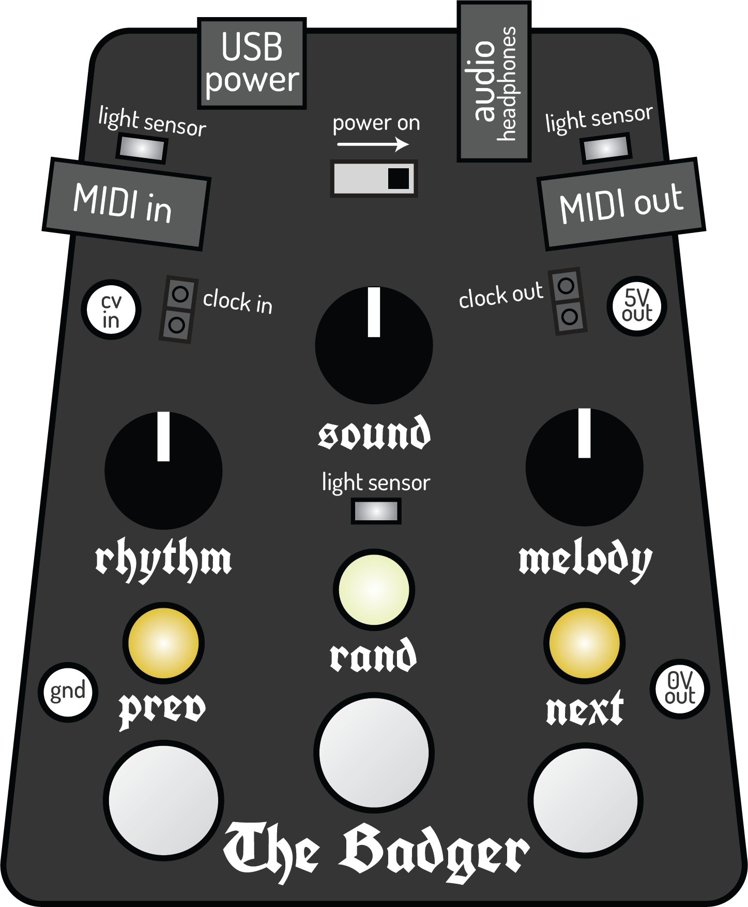
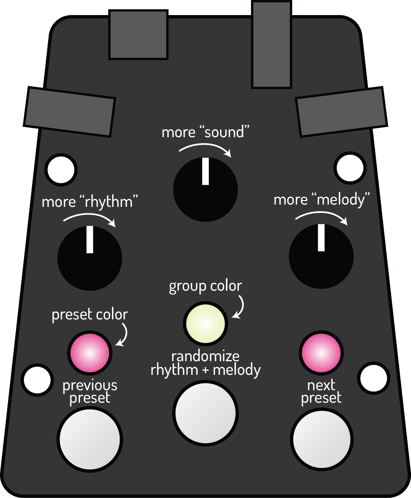
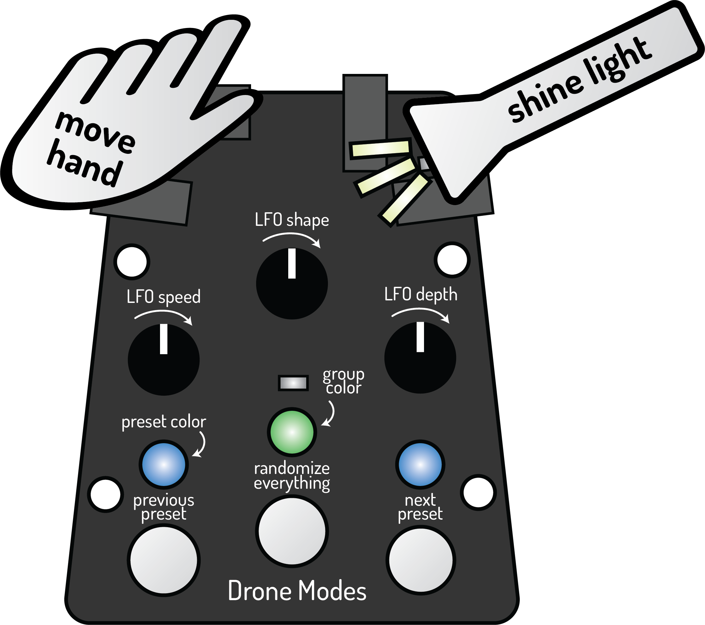
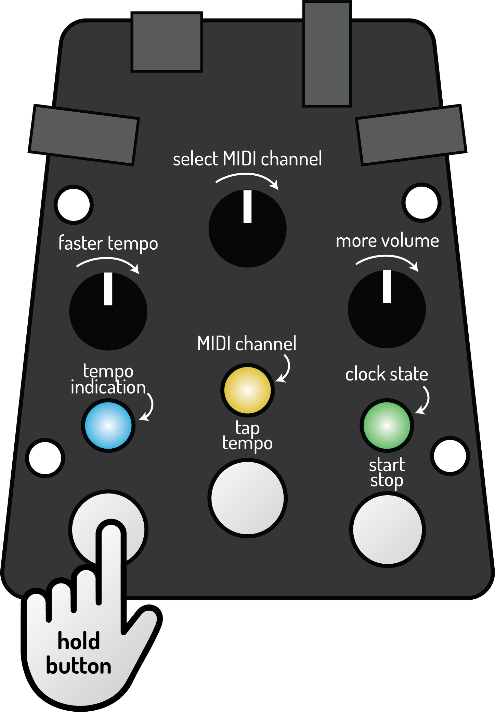
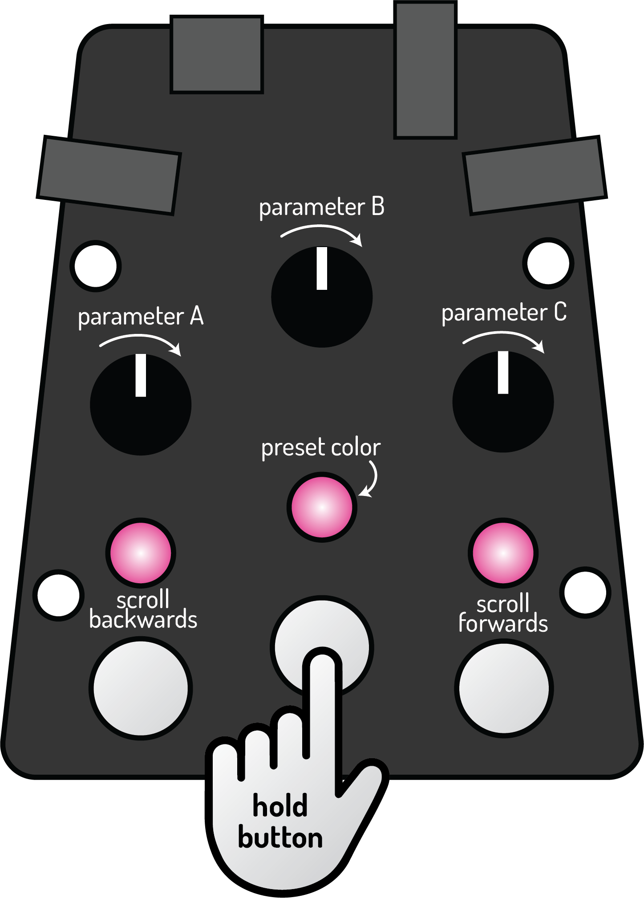
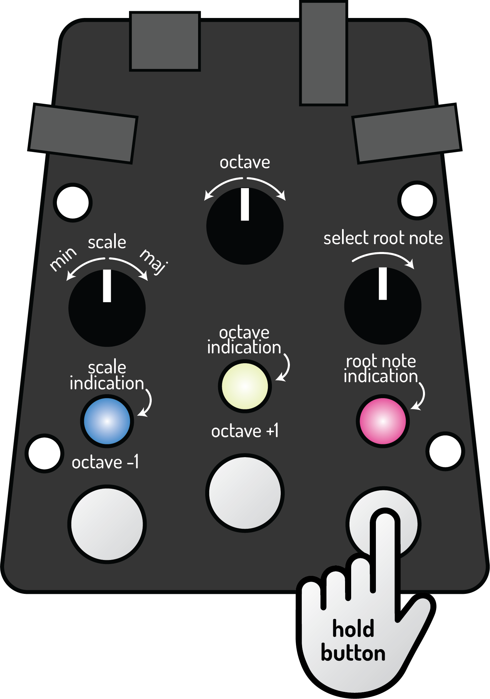

# The Badger: Full User Manual

“The cheapest *fully featured* synth ever.”

Plug The Badger into USB power and slide the power switch to the right. It boots straight into **Preset #1 Synth (Yellow)**.

## Overview

**Buttons:** Prev, Rand, Next

**Potentiometers:** Rhythm, Sound, Melody

**LEDs:** 3 RGB LEDs (each has 7 colors)

**Light sensors:** 3 ambient light sensors (averaged for the best results)

**Connections:**

- USB-C (Power, USB MIDI, Firmware Update)
- Headphone Out (TRS Jack, 200mW/channel @ 32Ω)
- MIDI In / MIDI Out (TRS Jack, Type A)
- Clock In / Clock Out (patch points, 0–5V)
- CV IN (4mm banana-style, 0–5V)
- GND (4mm banana-style)
- True / False (4mm banana-style, fixed 5V / 0V reference points)
- SWD (for firmware flashing using a debug probe)

**Power consumption:** ~30mA @ 5V (can run for dozens of hours on a powerbank)

## Presets

18 presets, grouped by color: **Melodies** (white group indicator), **Drums** (blue group indicator), **Drones** (green group indicator). Each preset's own LED color is shown below. The center LED shows the group color while a note or envelope is active, and the preset's own color while idle; the outer LEDs do the opposite, flashing the preset color on activity.

Every preset also responds to incoming MIDI notes, pitch bend, velocity, aftertouch, and the CV input (see below), independent of the internal sequencer settings shown here.

Due to hardware limitations, multiple presets can share the same color!

### Melody presets ( White)

| #   | Preset                                                                                                | Description                                                                      | Parameter A                   | Parameter B       | Parameter C              |
| --- | ----------------------------------------------------------------------------------------------------- | -------------------------------------------------------------------------------- | ----------------------------- | ----------------- | ------------------------ |
| 1   |  **Synth**        | Classic square+saw synth with a filter envelope – a “303-style” acid sound       | Oscillator mix (square – saw) | Distortion drive  | Filter resonance         |
| 2   |  **Witch Saw**  | Three detuned saw oscillators (plus sub) for dark/witch-house pads and leads     | Detune amount                 | Filter cutoff     | Filter resonance         |
| 3   |  **Organ**              | Chord organ – each note plays a full triad/voicing                               | Chord voicing (5 options)     | Filter cutoff     | Filter resonance         |
| 4   |  **Electric Piano** | FM electric piano                                                                | FM ratio                      | FM amount         | Tremolo depth            |
| 5   |  **Bell**             | Inharmonic FM bell                                                               | FM ratio                      | FM amount         | Tremolo depth            |
| 6   |  **Flute**            | Soft digital FM flute, holds its envelope while a note is held                   | FM ratio                      | FM amount         | Tremolo depth            |
| 7   |  **Chiptune**   | NES-style square wave lead with a sub-oscillator and an 8-bit pitch-slide effect | Sub-oscillator octave         | Pitch-slide depth | Additional noise amount  |
| 8   |  **Bass Guitar**        | Plucked-string bass (Karplus-Strong synthesis)                                   | Tone brightness               | Distortion drive  | Per-note tone randomness |

### Drum presets ( Blue)

| #   | Preset                                                                                                 | Description                                        | Parameter A           | Parameter B         | Parameter C            |
| --- | ------------------------------------------------------------------------------------------------------ | -------------------------------------------------- | --------------------- | ------------------- | ---------------------- |
| 9   |  **Classic Drums** | Traditional-ish kick + snare                       | Kick pitch-drop depth | Distortion drive    | Filter cutoff          |
| 10  |  **8-Bit Drums** | Lo-fi downsampled kick + snare                     | Kick pitch-drop depth | Distortion drive    | Filter cutoff          |
| 11  |  **Tambourine**      | Tonal drum blended with filtered noise             | Drum pitch/overtone   | Noise filter cutoff | Noise filter resonance |
| 12  |  **Woodblock**         | Short, bright tonal knock                          | Drum pitch/overtone   | Noise filter cutoff | Noise filter resonance |
| 13  |  **Clap**              | Multi-hit filtered noise clap (909-style)          | Drum pitch/overtone   | Noise filter cutoff | Noise filter resonance |
| 14  |  **Laser Drums**         | Aggressive pitch-modulated kick with a tight snare | Kick pitch-drop depth | Distortion drive    | Filter cutoff          |

### Drone presets ( Green)

Drones are ambient, evolving textures – they ignore the step sequencer and instead use an LFO to sweep the filter or the oscillator pitches over time. Pressing **RAND** on a Drone randomizes *all* of its knobs (both local and global) rather than the rhythm/melody, since drones don't use those.

| #   | Preset                                                                                                  | Description                         | Parameter A     | Parameter B        | Parameter C      |
| --- | ------------------------------------------------------------------------------------------------------- | ----------------------------------- | --------------- | ------------------ | ---------------- |
| 15  |  **Rain & Thunder** | Dark, resonant noise-driven rumble  | Harmonic offset | Filter cutoff base | Filter resonance |
| 16  |  **Digital Hive** | Bright, buzzing clustered harmonics | Harmonic offset | Filter cutoff base | Filter resonance |
| 17  |  **Under Water**        | Deep, muffled, slowly-moving bed    | Harmonic offset | Filter cutoff base | Filter resonance |
| 18  |  **Bird Song**          | Chirpy, fast-moving high harmonics  | Harmonic offset | Filter cutoff base | Filter resonance |

For all four Drone presets, the **Normal-layer knobs** shape the modulation instead of rhythm/melody:

- **RHYTHM** – LFO speed (from roughly one cycle per 15 minutes up to 20 Hz – depending on the preset).
- **SOUND** – LFO waveform blend (morphs through ramp → square → saw → triangle → noise).
- **MELODY** – LFO depth. On some Drone presets this is additionally pushed by the onboard **light sensors** – covering them or shining light on them shifts the modulation depth or the oscillator octaves, depending on the preset.

## The Control Layers

Buttons work in two ways:

- **Tap** (press and release quickly): triggers an immediate action.
- **Hold**: opens a “layer” where turning RHYTHM / SOUND / MELODY controls something else, and the other two buttons gain secondary functions. Release the held button to return to normal.

### Normal layer (Melody and Drum presets – Synth, Classic Drums...)

- **RHYTHM** selects one of the built-in rhythm patterns.
- **SOUND**'s function depends on the active preset.
- **MELODY** selects one of the built-in melody patterns.
- **Tap PREV** goes to the previous preset.
- **Tap RAND** randomizes the current preset – see the Randomize section below.
- **Tap NEXT** goes to the next preset.

### Normal layer (Drone presets – Rain & Thunder, Digital Hive...)

- **RHYTHM** controls LFO speed.
- **SOUND** controls LFO shape.
- **MELODY** controls LFO depth.
- **Light Sensors** add/subtract LFO depth or octaves (based on the preset).

**LFO Shapes**

### Hold PREV – Utilities layer

- **RHYTHM**'s options depend on which clock source is currently active: internal tempo (15–250 BPM), MIDI clock divider options, or external clock multiplier/divider options.
- **SOUND** selects the MIDI channel: Omni, then channels 1–16.
- **MELODY** sets the main volume.
- **Tap RAND** registers a tap-tempo beat (tap a few times in a row to set the internal tempo by feel).
- **Tap NEXT** starts or stops the clock.
- LEDs: Left LED blinks with the clock (blue = internal, cyan = MIDI, magenta = external); Center LED shows the MIDI channel color (white = Omni); Right LED is green when running, red when stopped.

#### MIDI Channel

| Channel               | Color                                                                                          | Outputs MIDI notes |
| --------------------- | ---------------------------------------------------------------------------------------------- | ------------------ |
| Omni (Listens to all) |  White       | ❌                  |
| 1                     |  Blue          | ✅                  |
| 2                     |  Cyan          | ✅                  |
| 3                     |  Green       | ✅                  |
| 4                     |  Magenta | ✅                  |
| 5                     |  Red             | ✅                  |
| 6                     |  Yellow    | ✅                  |
| 7                     |  Blue          | ✅                  |
| 8                     |  Cyan          | ✅                  |
| 9                     |  Green       | ✅                  |
| 10                    |  Magenta | ✅                  |
| 11                    |  Red             | ✅                  |
| 12                    |  Yellow    | ✅                  |
| 13                    |  Blue          | ✅                  |
| 14                    |  Cyan          | ✅                  |
| 15                    |  Green       | ✅                  |
| 16                    |  Magenta | ✅                  |

### Hold RAND – Preset sound layer

Turning RHYTHM/SOUND/MELODY here edits the **current preset's own three knobs** – these are saved per-preset (each preset remembers its own knob positions independently). Tap PREV/NEXT to scroll the presets (see above). LEDs show the preset's color on all three LEDs while held.

Preset scrolling activates automatic preset changes every 4 clock ticks (1 bar). You can press PREV or NEXT again to jump forward or backward over multiple presets. Pressing PREV or NEXT on its own cancels the scrolling.

### Hold NEXT – Scale & Key layer

- **RHYTHM** selects one of 7 quantization scales: Minor Chord, Minor Pentatonic, Minor Diatonic, Chromatic (default), Major Diatonic, Major Pentatonic, Major Chord.
- **SOUND** sets the octave transposition (±3 octaves). Tap PREV/RAND to nudge it down/up by one octave instead. **Octave is not autosaved** – it resets to center (0) on every power-up.
- **MELODY** sets the root note (C through B).
- LEDs show the current scale / octave / root note as different colors while held.

#### Scales

| #   | Scale               | Color                                                                                          | Semitones                            |
| --- | ------------------- | ---------------------------------------------------------------------------------------------- | ------------------------------------ |
| 1   | Minor Chord         |  Blue          | 0, 3, 7                              |
| 2   | Minor Pentatonic    |  Cyan          | 0, 3, 5, 7, 10                       |
| 3   | Minor Diatonic      |  Green       | 0, 2, 3, 5, 7, 8, 10                 |
| 4   | Chromatic (default) |  White       | 0, 1, 2, 3, 4, 5, 6, 7, 8, 9, 10, 11 |
| 5   | Major Diatonic      |  Magenta | 0, 2, 4, 5, 7, 9, 11                 |
| 6   | Major Pentatonic    |  Red             | 0, 2, 4, 7, 9                        |
| 7   | Major Chord         |  Yellow    | 0, 4, 7                              |

#### Octaves

| Offset | Color                                                                                          |
| ------ | ---------------------------------------------------------------------------------------------- |
| -3     |  Blue          |
| -2     |  Cyan          |
| -1     |  Green       |
| 0      |  White       |
| 1      |  Magenta |
| 2      |  Red             |
| 3      |  Yellow    |

#### Root Notes

| Note | Color                                                                                          |
| ---- | ---------------------------------------------------------------------------------------------- |
| C    |  Blue          |
| C#   |  Cyan          |
| D    |  Green       |
| D#   |  Magenta |
| E    |  Red             |
| F    |  Yellow    |
| F#   |  Blue          |
| G    |  Cyan          |
| G#   |  Green       |
| A    |  Magenta |
| A#   |  Red             |
| B    |  Yellow    |

## Sequencer

A 16-step sequencer that outputs two sets of notes and triggers/gates. It's controlled by the RHYTHM and MELODY potentiometers, and can be quantized or randomized.

The sequencer includes 21 sets of presets and melodies (these cannot be changed unless the firmware is modified).

When a MIDI Note On message arrives, the sequencer is disabled until the Badger is restarted or the MIDI channel is changed.

## Light Sensors

The sensors are averaged for the best results, and are automatically calibrated to the ambient light whenever you switch presets.

They're used by the Drone presets (see above) to let the room's lighting affect the modulation depth or the oscillator octaves – try waving a hand over them or shining a light onto them.

## Randomize

Tapping **RAND** in the Normal layer randomizes the current preset:

- On Melody and Drum presets: generates a new rhythm pattern and a new melody pattern (quantized to the current scale), so tapping RAND repeatedly gives you quick musical variations without touching a knob.
- On Drone presets: randomizes every knob (local and global) instead, giving you a completely new texture.

When the Chromatic scale is selected, melody randomization first chooses a scale from the list below, then randomizes notes according to it.

| Randomizer Scale | Semitones            |
| ---------------- | -------------------- |
| Minor Scale      | 0, 3, 7              |
| Minor Pentatonic | 0, 3, 5, 7, 10       |
| Minor Diatonic   | 0, 2, 3, 5, 7, 8, 10 |
| Major Diatonic   | 0, 2, 4, 5, 7, 9, 11 |
| Major Pentatonic | 0, 2, 4, 7, 9        |
| Major Scale      | 0, 4, 7              |
| Hungarian Minor  | 0, 2, 3, 5, 7, 8, 11 |
| Phrygian         | 0, 1, 3, 5, 7, 8, 10 |
| Aeolian          | 0, 2, 3, 5, 7, 8, 10 |
| Ionian           | 0, 2, 4, 5, 7, 9, 11 |
| Lydian           | 0, 2, 4, 6, 7, 9, 11 |
| Wholetone        | 0, 2, 4, 6, 8, 10    |

Triggers/Gates are purely random (based on a seed created from analog inputs, button presses, and runtime).

## MIDI

The Badger can respond to various MIDI messages. When a clock message is received, it switches to the MIDI clock. When a note message is received, the internal sequencer is disabled (until you restart the Badger or change the MIDI channel).

- **In/Out MIDI channel**: set via Hold PREV → SOUND (Omni or channel 1–16, see the color codes below). Omni listens to all channels.
- **Incoming Notes**: incoming Note On/Off drives the “primary” voice of whichever preset is selected (monophonic – the Badger tracks one held note at a time). Velocity scales the output volume of the triggered note. A Note On with velocity 0 is treated as a Note Off.
- **Outgoing Notes**: when the channel is set to 1–16 (not Omni), the Badger outputs the internally generated notes on that channel.
- **Aftertouch**: both Channel (global) and Polyphonic aftertouch scale the output volume of the held note, on the same curve as note-on velocity – so pressing harder after the attack swells the note. Polyphonic aftertouch is only applied when its note number matches the note the Badger is playing; pressure for any other note is ignored. Aftertouch received while no note is held does nothing, and pressure changes are ramped over a few milliseconds so the coarse steps controllers send don't click. Only presets that keep sounding for as long as the note is held respond to it: **Synth**, **Witch Saw**, **Organ** and **Flute**. The struck and plucked presets have decayed before pressure can build up, and the Drones aren't gated by the note at all, so all of those ignore aftertouch and follow note-on velocity alone.
- **Pitch bend**: standard 14-bit pitch bend, range ±7 semitones. It's combined additively with the CV input (see below) – both can bend pitch at the same time.
- **Program Change**: selects a preset (0–127 maps proportionally across all 18 presets, the same way CC 1 does below).
- **Panic**: CC 120 (All Sound Off) or CC 123 (All Notes Off) releases whatever note is currently held.
- **Clock sync**: the Badger can follow incoming MIDI clock (Start/Stop/Continue included) as its transport source, and also sends MIDI clock out. Select clock dividers/multipliers with Hold PREV → RHYTHM.
- **Passthrough**: incoming MIDI is passed through to MIDI Out.

### MIDI CC map

| CC  | Function                               |
| --- | -------------------------------------- |
| 1   | Select preset (0–127 mapped to 0–18)   |
| 14  | Select scale (0–127 mapped to 0–7)     |
| 15  | Set root note (0–127 mapped to 0–11)   |
| 16  | Set octave offset (0–127 mapped to ±3) |
| 17  | RHYTHM Potentiometer                   |
| 18  | SOUND Potentiometer                    |
| 19  | MELODY Potentiometer                   |
| 20  | Active Preset Parameter A              |
| 21  | Active Preset Parameter B              |
| 22  | Active Preset Parameter C              |
| 120 | All Sound Off (panic)                  |
| 123 | All Notes Off (panic)                  |

> Once a CC message takes over a control, the physical knob is ignored until you physically turn it again, at which point it takes back control.

## CV & Clock I/O

- **CV IN** (banana jack, 0.25V–5V) tracks pitch in standard **1V/octave** fashion, and is added directly to the MIDI pitch bend signal – so patching in an external sequencer or keyboard's CV output will transpose whatever the Badger is playing. Readings below ~0.25V are treated as 0V, to reject noise on the input when nothing is patched in. The calibration is factory-approximate; don't expect any precise pitches from this input.
- **Clock IN / OUT** (patch points) let you sync the Badger's tempo to, or drive, other gear using simple pulse/gate signals – Hold PREV and turn RHYTHM to select the incoming clock divider/multiplier.
- **TRUE / FALSE** (banana jacks) are fixed 5V and 0V reference points, wired directly in hardware – handy for patching logic-level signals. They aren't controlled by the firmware.
- **GND** (banana jack) is the common ground reference for the banana jacks.

## Saving & Memory

Settings are automatically saved a few seconds after you stop touching a control that needs saving – you don't need to do anything.
You may notice a brief blip in the audio when a save happens. This is normal – the same flash memory holds the firmware, so a save briefly pauses the CPU.

- **What's saved:** main volume, clock tempo/source settings, MIDI channel, scale, root note, and every preset's own three knob positions.
- **What's *not* saved:** which preset was active, and the octave transposition. Preset knobs moved via incoming MIDI CC are also *not* auto-saved, so a sequencer or DAW automating your knobs won't wear out the memory or overwrite your hand-tuned settings.

## Factory Reset

Hold button **RAND** while powering on. The LEDs will blink green (success) or red (failure) while the button is held – release to finish. This restores all saved settings (volume, clock, MIDI channel, scale, root note, and every preset's knob positions) to their defaults.

## Firmware Update

Connect the Badger to your computer, hold **PREV** button and turn the Badger on. A new USB drive `BADGERBOOT` appears. Drag the UF2 firmware onto the USB drive. After upload the Badger automatically resets into the new firmware.

## Firmware Version Display (and The Easter Egg 🦡)

Hold **all three buttons together for 3 seconds**. All three LEDs blink 8 times, each blink showing the firmware version encoded as three colors, while the audio plays a “secret sample”. It returns to normal automatically afterward.

### Color table

| Number | Color                                                                                          |
| ------ | ---------------------------------------------------------------------------------------------- |
| 0      |  None       |
| 1      |  Green       |
| 2      |  Blue          |
| 3      |  Red             |
| 4      |  Yellow    |
| 5      |  Magenta |
| 6      |  Cyan          |

### Examples

| Version | Color combination                                                                                                                                                                                                                                          |
| ------- | ---------------------------------------------------------------------------------------------------------------------------------------------------------------------------------------------------------------------------------------------------------- |
| 0.0.5   |  |
| 1.0.0   |      |
| 1.0.1   |      |
| 1.0.2   |        |
